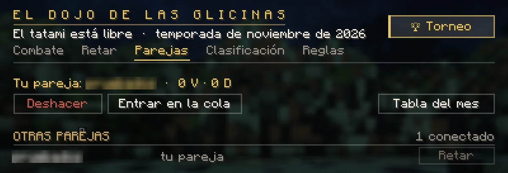
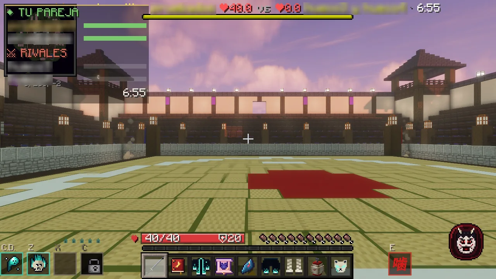

# Duelos en pareja: 2 contra 2

Pelea en el tatami con un compañero, contra otra pareja. Las reglas son las de un <a href="../duelos/">duelo</a>: nadie pierde nada, nadie muere, todos con los mismos corazones y al acabar cada uno vuelve a donde estaba, como estaba.

## Formar pareja

- **Invita** con **`/duelo pareja <jugador>`** o desde el dojo: `/duelo dojo` → pestaña **Parejas** → **Invitar**.
- El otro recibe el aviso con los botones **[✔ ACEPTAR] [✖ RECHAZAR]** y unos segundos para contestar.
- Una pareja dura mientras los dos sigáis conectados. Para cambiar de compañero: `/duelo pareja deshacer`.
- Hace falta lo mismo que para cualquier duelo: tu espada nichirin (o, si eres un demonio, la sangre despierta). Una pareja puede ser de un cazador y un demonio: en el tatami sois compañeros.

<figure markdown="span">
  { loading=lazy }
  <figcaption>La pestaña Parejas: tu compañero, la cola, las otras parejas y la tabla del mes.</figcaption>
</figure>

## Pelear

Hay dos maneras:

- **Retar a otra pareja:** `/duelo pareja retar <uno de ellos>` o el botón **Retar** de la pestaña Parejas. Puede aceptar cualquiera de los dos.
- **La cola de parejas:** `/duelo pareja cola` o el botón **Entrar en la cola**. En cuanto haya otra pareja y quede libre el tatami, os toca. Mientras esperáis no se viaja (como en la cola de los duelos); se sale con `/duelo pareja salir` o el botón, y a los 5 minutos sin rival os saca sola.

Cuando os toca, **parad y no os mováis**: dos segundos de aviso y el humo. Si alguno se mueve o recibe daño, se cancela (si veníais de la cola, la pareja que se movió sale de ella; la otra sigue, la primera). Después, cada uno a su marca en el tatami: **3 · 2 · 1 · ¡LUCHAD!**

## Durante el combate

- **Tus técnicas no le hacen nada a tu compañero**, ni las suyas a ti: ni daño, ni efectos, ni empujones. Tus flechas y proyectiles le atraviesan, lo que invocas no le persigue. Puedes lanzar todo lo que tengas con él al lado.
- Arriba a la izquierda ves a tu pareja y a los rivales con su vida y, sobre las cabezas, tu pareja en **verde** y los rivales en **rojo**.
- **Si caes, no mueres:** el golpe que te tumbaría te deja fuera. Miras desde arriba, en modo espectador, hasta que acabe. Lo que hayas invocado se va contigo.
- **Fuera del tatami:** 5 segundos para volver. Cada uno tiene su cuenta; si se te acaba, caes.
- **Rendirse** (`/duelo rendirse` o el botón de la pestaña Combate): caes tú, tu pareja sigue sola.
- **Si te vas del servidor**, pierdes tu parte: vuelves a tu sitio y la pelea sigue sin ti.
- **Gana el bando que deje al otro sin nadie.** Si los dos últimos caen a la vez, empate. Si se acaba el tiempo (7 minutos), gana el bando con más vida sumando a los dos; igualados, empate.

Como en los duelos de siempre: sin comer ni beber, sin pociones, sin tirar ni recoger nada. Las técnicas de quien mira no entran y nadie más pisa el tatami.

<figure markdown="span">
  { width="760" loading=lazy }
  <figcaption>El combate: arriba a la izquierda, tu pareja y los rivales con su vida; arriba, el marcador y el tiempo.</figcaption>
</figure>

## Puntos

Las victorias en pareja **van aparte**: no tocan tus puntos del dojo, ni tu racha ni tu clan. Cada pareja tiene sus victorias, sus derrotas y su racha, y hay una **tabla del mes** (pestaña Parejas → **Tabla del mes**).

- Entre las mismas dos parejas solo puntúan **3 combates al día**; si dos rivales juegan desde la misma conexión, es amistoso.
- Un combate sin pelea de verdad no puntúa (20 segundos, o que el que pierde haya recibido golpes).
- En este modo no hay apuestas.

Títulos: **Dúo del Dojo** (tu primera victoria en pareja) y **Pareja del Dojo** (10 victorias).

## Órdenes

| Orden | Qué hace |
|---|---|
| `/duelo pareja <jugador>` | Invitarle a ir en pareja |
| `/duelo pareja aceptar` · `rechazar` | Contestar a una invitación |
| `/duelo pareja deshacer` | Dejar de ir en pareja |
| `/duelo pareja retar <jugador>` | Retar a su pareja |
| `/duelo pareja aceptarreto` · `rechazarreto` | Contestar a un reto |
| `/duelo pareja cola` · `salir` | La cola de parejas |
| `/duelo rendirse` | Caer (tu pareja sigue) |
