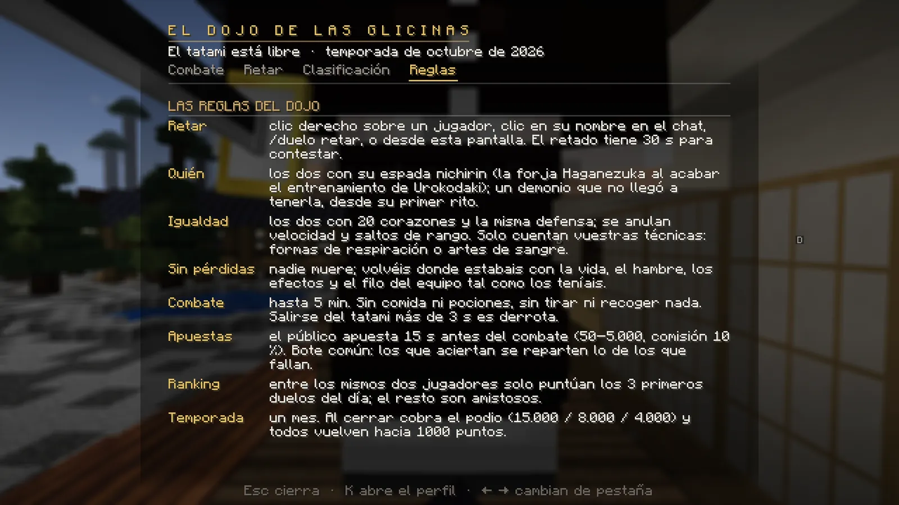
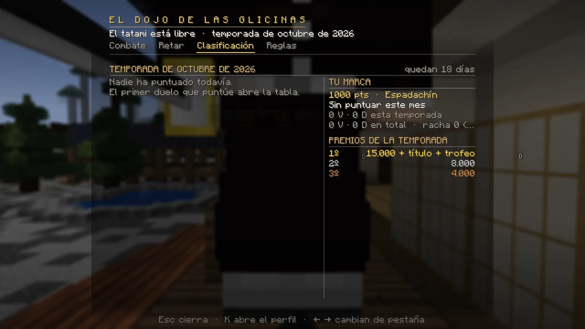

# Duelos y dojo

En el Dojo de las Glicinas te bates a espada con otro jugador. Los dos entráis iguales y nadie pierde nada: al acabar, cada uno vuelve a donde estaba.

## Requisitos

- Tener tu **katana nichirin** (te la forja el herrero al terminar tu formación). Un demonio, desde su primer rito.
- No estar peleando, en otro duelo ni congelado.

## Cómo retar

- **Clic derecho sobre un jugador** (mejor con la mano vacía): se abre su ficha con el botón **«⚔ Retar a duelo»**.
- **Clic en su nombre en el chat**: deja escrito `/duelo retar <nombre>`.
- **`/duelo retar <jugador>`**.
- Desde la pantalla del dojo (pestaña **Retar**): habla con el **Maestro del Dojo** o escribe `/duelo dojo`.

El retado tiene **30 segundos** para pulsar **[✔ ACEPTAR]** o **[✖ RECHAZAR]** en el chat (o `/duelo aceptar` / `/duelo rechazar`).

## Cómo es un duelo

1. **Humo (3 s):** quédate quieto. Si conoces varias respiraciones, el Maestro te pregunta con cuál vas a luchar.
2. **El tatami:** los dos aparecéis en vuestras marcas con la vida y la comida al máximo. Si puntúa, hay unos segundos de **apuestas**.
3. **3 · 2 · 1 · ¡LUCHAD!** Hasta 5 minutos. Arriba ves la vida de los dos y el tiempo.
4. **El final:** el golpe que mataría no mata: decide el combate. Salirte del tatami más de 3 segundos es derrota. Si se
   acaba el tiempo, gana quien conserve más vida.

**Reglas del tatami:** los dos con **20 corazones** y la misma defensa (la ropa y la armadura no cuentan), sin ventajas
de rango ni VIP. Solo cuentan **vuestras técnicas**: formas de respiración o artes de sangre. No se come, no se bebe y
no se tira ni se recoge nada. Al acabar recuperas tu sitio, tu vida, tu comida y el desgaste de tu equipo.

<figure markdown="span">
  { loading=lazy }
  <figcaption>La pestaña Reglas del dojo lo resume todo.</figcaption>
</figure>
<figure markdown="span">
  { loading=lazy }
  <figcaption>Clasificación: tu marca, los 10 primeros de la temporada y los premios.</figcaption>
</figure>

## Puntuación y temporadas

- Todos empiezan con **1.000 puntos**. Ganar sube y perder baja, según el nivel del rival.
- Escalafón: Aprendiz · **Espadachín** (900) · **Veterano** (1.100) · **Maestro** (1.250) · **Leyenda del Dojo** (1.400).
- **Cuándo puntúa:** solo si hay combate de verdad (20 segundos o golpes), entre conexiones distintas, y **3 duelos al
  día como mucho entre los mismos dos jugadores**. Los demás son **amistosos**.
- **Temporada:** un mes. Al cerrar, los tres primeros (con al menos 5 duelos puntuables) cobran **15.000, 8.000 y
  4.000**. El campeón gana además el título **«Campeón del Dojo»** y el **Trofeo del Dojo**. Después, los puntos de todos
  se acercan a 1.000.
- Títulos: **Duelista** (1.ª victoria), **Espada del Dojo** (10) e **Invicto** (racha de 5).

## Apuestas

En los duelos que puntúan, antes del 3-2-1 se abren **15 segundos de apuestas**. Llega un aviso al chat con botones
**[100] [500] [1000]**; o usa `/duelo apostar <duelista> <cantidad>`.

- Entre **50 y 5.000**, una apuesta por duelo. No pueden apostar los duelistas, ni su clan, ni desde su misma conexión.
- **Bote común:** los que aciertan recuperan lo suyo y se reparten lo de los que fallan (menos un 10 %).
- Si hay empate, el duelo no puntúa o se corta, se devuelve todo.

## Ver un duelo

Con un combate en marcha, **`/duelo ver`** (o el botón de la pantalla del dojo) te lleva a la **grada** como espectador.
Vuelves con `/duelo ver` otra vez.

## El Trofeo del Dojo

El campeón de cada mes recoge su trofeo en el dojo (**Clasificación → «✦ Reclamar trofeo»**) o con **`/duelo trofeo`**.
Es un trofeo 3D con su nombre, el mes y sus puntos que se coloca en **su casa de alquiler**. No se vende.

## Comandos

| Comando | Qué hace |
|---|---|
| `/duelo retar <jugador>` | Reta a duelo. |
| `/duelo aceptar` · `/duelo rechazar` | Responde a un reto. |
| `/duelo rendirse` | Te rindes (en el humo, solo cancela). |
| `/duelo apostar <duelista> <cantidad>` | Apuesta en el duelo que va a empezar. |
| `/duelo dojo` | Abre la pantalla del dojo. |
| `/duelo ver` | Entra o sale de la grada. |
| `/duelo top` · `/duelo marcador [jugador]` | Top 10 de la temporada · victorias y derrotas. |
| `/duelo trofeo` | Recoge tu Trofeo del Dojo. |
