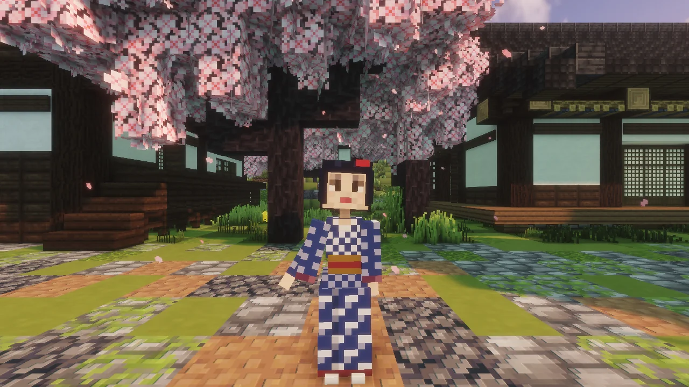
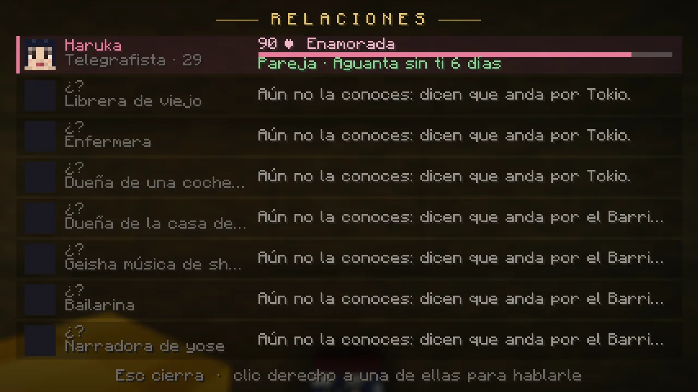
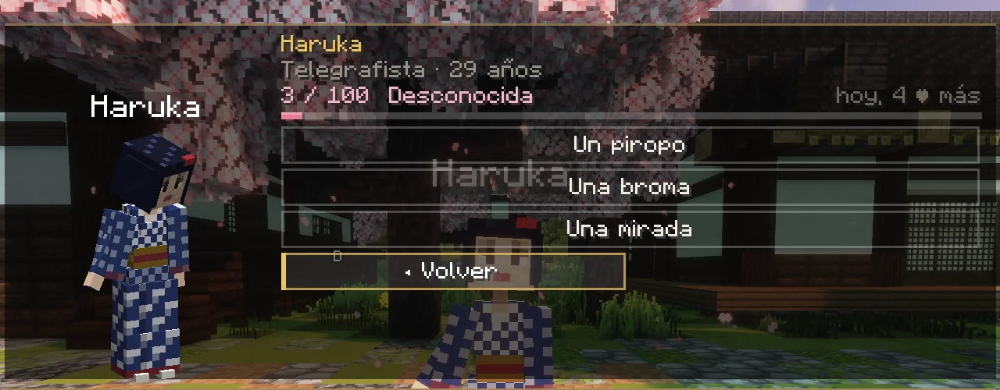
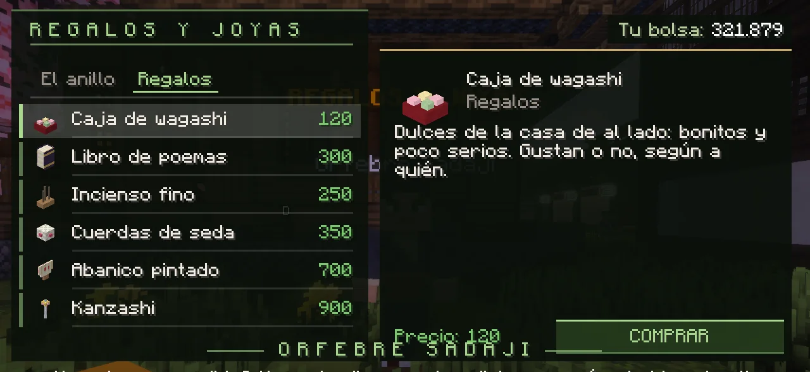

# Relaciones y pareja

Por Tokio y por el Barrio del Placer hay <strong>ocho mujeres con su vida, su carácter y su historia</strong>. Puedes conocerlas, hablar con ellas, traerles regalos, hacerles favores, invitarlas a salir y, si la cosa va bien, pedirle a una que viva contigo y hasta casarte con ella.

Cada jugador tiene su propia historia con cada una: varios pueden cortejar a la misma sin chocar. Todo es romántico y apto para todos los públicos: piropos, sonrojos, ir de la mano y, como mucho, un beso en la mejilla o en la frente. Y no da ninguna ventaja en combate.

<figure markdown="span">
  { loading=lazy }
  <figcaption>Haruka, una de las ocho, bajo los cerezos de Tokio.</figcaption>
</figure>
<figure markdown="span">
  { loading=lazy }
  <figcaption>K → ♥ Relaciones: las ocho, lo que hay con cada una y por dónde anda la que aún no conoces.</figcaption>
</figure>

## Quiénes son

| Quién | Edad | Qué hace | Por dónde anda |
|---|---|---|---|
| **Haruka** | 29 | Telegrafista: sabe de todos y no cuenta nada | Tokio, hacia x 400, z -400 |
| **Ayame** | 32 | Librera de viejo, viuda y lectora empedernida | Tokio, hacia x 485, z -380 |
| **Natsu** | 26 | Enfermera, directa y sin un minuto libre | Tokio, hacia x 610, z -370 |
| **Kaede** | 28 | Dueña de una cochera de rickshaws, y tira ella si hace falta | Tokio, hacia x 490, z -350 |
| **Kikuno** | 31 | Dueña de la casa de té Tsukimi | Barrio del Placer, hacia x 1138, z 805 |
| **Koharu** | 25 | Geisha música: toca el shamisen y habla poco | Barrio del Placer, hacia x 1078, z 826 |
| **Someka** | 27 | Bailarina, y de las que lo dicen | Barrio del Placer, hacia x 1084, z 898 |
| **Ranko** | 30 | Narradora de yose: cuenta cuentos y no se calla | Barrio del Placer, hacia x 1172, z 780 |

Tienen rutina: por la mañana, por la tarde y por la noche están en sitios distintos de su barrio, siempre cerca. **K → ♥ Relaciones** (o **`/pareja`**) te dice en qué parte de la ciudad buscar a cada una.

## Hablar con ellas

Clic derecho sobre ella abre su conversación. Arriba ves tus **corazones** (de 0 a 100) y cómo te considera:

**Desconocida** → **Conocida** (20) → **Amiga** (40) → **Cercana** (60) → **Enamorada** (80)

Lo que puedes hacer con ella:

- **Hablar.** Una vez al día te da corazones. Lo que dice cambia con lo que hay entre vosotros.
- **Coquetear.** Con un piropo, una broma o una mirada. Dos veces al día, y puede salir bien o mal: a cada una le gusta una manera y le molesta otra. Fíjate en cómo reacciona.
- **Regalar.** Una vez al día, lo que lleves en la mano. A cada una le encantan unas cosas y le molestan otras.
- **Un favor.** Uno al día: traerle algo, llevar un recado, acompañarla o quitarle a un pesado de encima.
- **Una cita**, desde 40 corazones: en la casa de té Tsukimi, en el [Ryōtei](../ciudadela/ryotei.md) de la Ciudadela o bajo los cerezos del Santuario. Quedáis, vas tú allí y te la encuentras esperando. No la dejes plantada.
- **Sus historias.** Tres, a los 20, 45 y 70 corazones. Te cuenta algo que le pasa y te pregunta qué harías. Lo que contestes importa, y se acuerda.

Puedes ganar **como mucho 6 corazones al día** con cada una; las citas y las historias van aparte. Ir a lo fácil no sirve: una relación lleva semanas.

<figure markdown="span">
  { loading=lazy }
  <figcaption>Su conversación: tus corazones arriba y lo que puedes hacer. Aquí, las tres maneras de coquetear.</figcaption>
</figure>

## Qué regalarles

El orfebre **Sadaji** (Tokio, hacia x 393, z -369, con su rótulo «REGALOS Y JOYAS») vende:

| Regalo | Precio |
|---|---|
| Caja de wagashi | 120 |
| Incienso fino | 250 |
| Libro de poemas | 300 |
| Cuerdas de seda | 350 |
| Abanico pintado | 700 |
| Kanzashi | 900 |

La [florista Sumire](../economia/plantas.md) te da plantas cuyas flores y cosechas también sirven: cerezo, glicina, lirio, té y hierbas. Y una reliquia de las que se encuentran por ahí vale más que nada, si a ella le gustan.

Pregúntale a cada una y mira qué pone cara de agradecer. Regalarle lo que no le gusta **resta**.

<figure markdown="span">
  { loading=lazy }
  <figcaption>«Regalos y joyas», la tienda del orfebre Sadaji.</figcaption>
</figure>

## Pedirle que sea tu pareja

Hace falta:

<ol class="pasos" markdown>
<li markdown>**85 corazones.**</li>
<li markdown>Haber oído **sus tres historias**.</li>
<li markdown>**Una [casa, una parcela](../economia/casas.md) o una [mansión](../ciudadela/yamanote.md) de la que seas el inquilino.** Sin casa, te lo dice ella.</li>
<li markdown>No tener ya pareja: **una a la vez**.</li>
</ol>

Si dice que sí, se va a vivir contigo. A partir de ahí está siempre en tu casa y **no sale de ella**. **Dentro de casa nada ni nadie puede hacerle daño**: ni otro jugador, ni una técnica, ni un monstruo. Los que pasen la verán y les saludará con la cabeza, pero no pueden conquistarla ni molestarla.

## Vivir con ella

Se la ve vivir: lee, cocina, riega tus [plantas](../economia/plantas.md) si piden agua, juega con la [mascota](../economia/mascotas.md) si tienes, duerme un rato. Cuando llegas sale a recibirte. Y en su conversación tienes:

- **Comida casera**, una vez al día: te llena y te deja **Bien comido** media hora.
- **Descansar**, una vez al día: un rato en casa y quedas **Bien descansado** dos horas (algo más de experiencia del [Pase Estelar](../pase.md#como-se-sube)).
- **Que se siente contigo**, y saludos y reverencias: si se los haces, te los devuelve.
- Si tienes otra propiedad, **mudarla** allí.

Nada de esto toca el combate.

## Cuidarla o perderla

Una pareja hay que cuidarla. Tiene un **ánimo**: contenta, tranquila, pensativa, triste, dolida. Lo ves en **K → ♥ Relaciones**, con lo que aguanta sin ti.

- Hablarle, regalarle, salir con ella, comer con ella o simplemente pasarte por casa le sube el ánimo. **Pasarte cada dos o tres días sobra.**
- A los **7 días sin hacerle caso** (10 si estáis casados) te escribe **una carta al buzón**.
- Si **3 días después** sigues sin aparecer, **se marcha**. Te deja otra carta y vuelve a su sitio, dolida. Volver a empezar con ella cuesta: se queda con 15 corazones y durante un mes no querrá ni oír hablar del tema.

**Si te vas a ausentar**, dile «me voy de viaje»: durante **14 días** no corre su reloj, y lo puedes pedir una vez al mes. Con «he vuelto» lo acabas antes. Los reinicios del servidor no cuentan nunca.

**Si pierdes la casa**, no te deja: se va contigo a otra propiedad tuya o, si no tienes, vuelve a su sitio de siempre y te espera hasta **30 días**. En cuanto vuelvas a tener casa, vuelve contigo.

## Prometerse y casarse

<ol class="pasos" markdown>
<li markdown>**El anillo.** Se encarga al orfebre Sadaji con **6 lingotes de oro**, **3 diamantes** y **40.000**. Tarda **un día real**; luego lo recoges. Se gasta al pedir matrimonio.</li>
<li markdown>**Pedirle matrimonio.** Tras **5 días de pareja**, con **90 corazones** y el anillo, en su conversación.</li>
<li markdown>**La boda.** Tras **3 días de prometidos**, habla con el sacerdote **Kannushi Tokiwa** en el Santuario de la Ciudadela. Cuesta **15.000**. Hay una ceremonia, y quien esté cerca lo ve y se entera. Si algo la corta, no se cobra otra vez: vuelve a hablar con él.</li>
</ol>

Al casarte tienes el título **«Casado/a con …»**, un **♥** junto a tu nombre en la lista de jugadores (++tab++) y más margen en su reloj (10 días en vez de 7).

## Dejarlo

Si la dejas tú, desde su conversación, hay una escena corta y vuelve a su sitio, dolida, como si se hubiera marchado. **Divorciarse cuesta 20.000.** Puedes volver a intentarlo con ella o probar con otra, pero el cariño perdido no vuelve solo.

## Preguntas

**¿Y si otro jugador vive con la misma?** No pasa nada: cada uno tiene su historia. En la calle sigue su rutina para los demás; solo quien vive con ella deja de verla en la calle, porque la tiene en casa.

**¿Da igual ser cazador o demonio?** Da igual: para ellas eres una persona, y todas te hablan igual.

**¿Cuánto tarda todo?** Con el tope de cada día, unas dos semanas o más hasta poder pedirle salir. Es a propósito.
