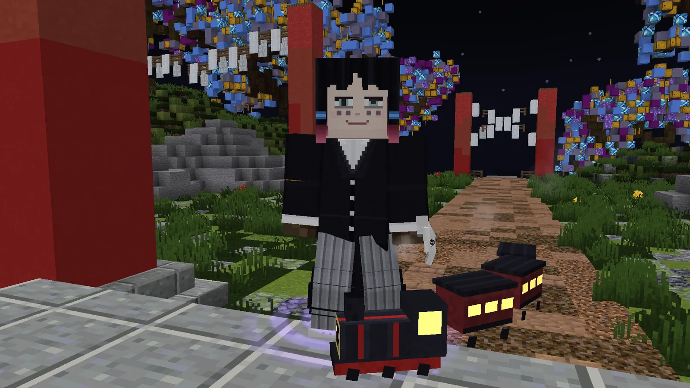
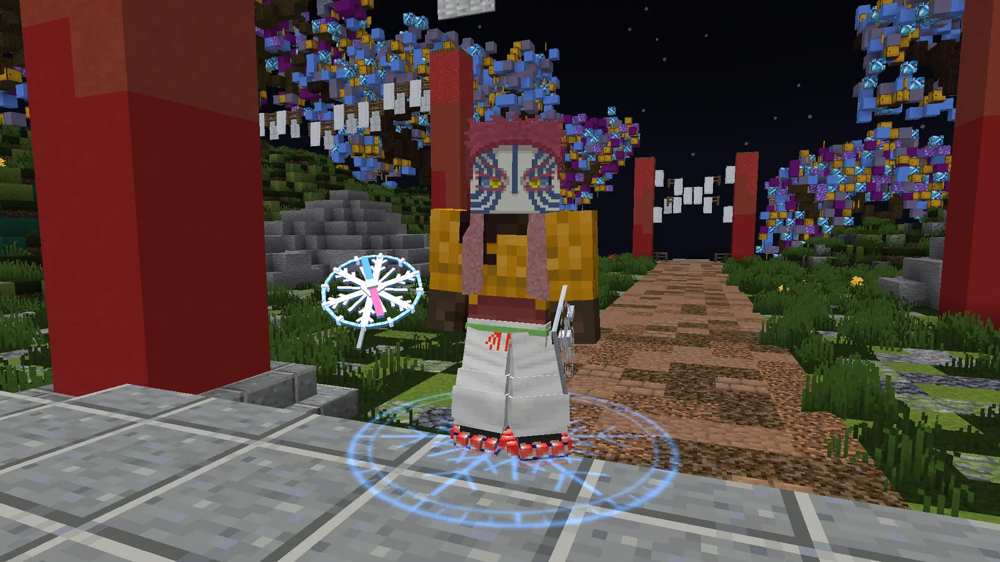
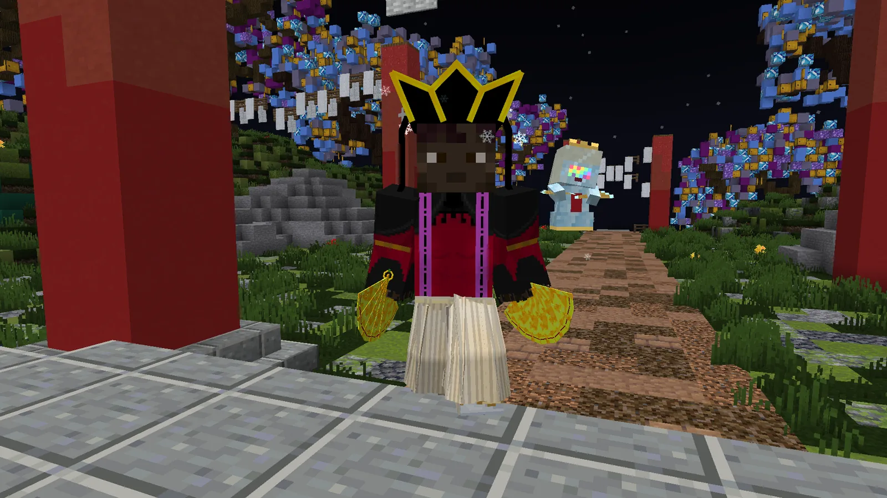
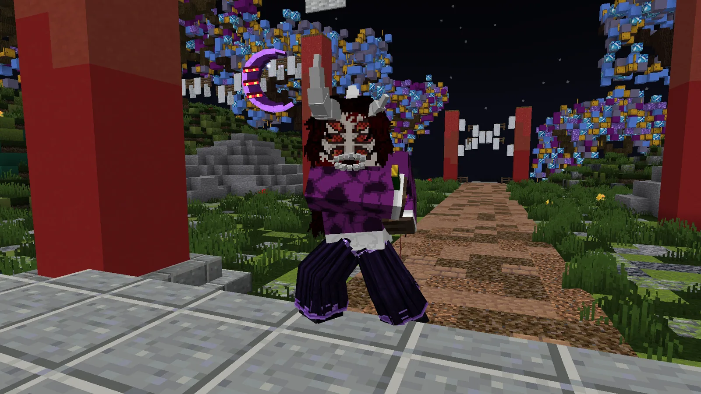
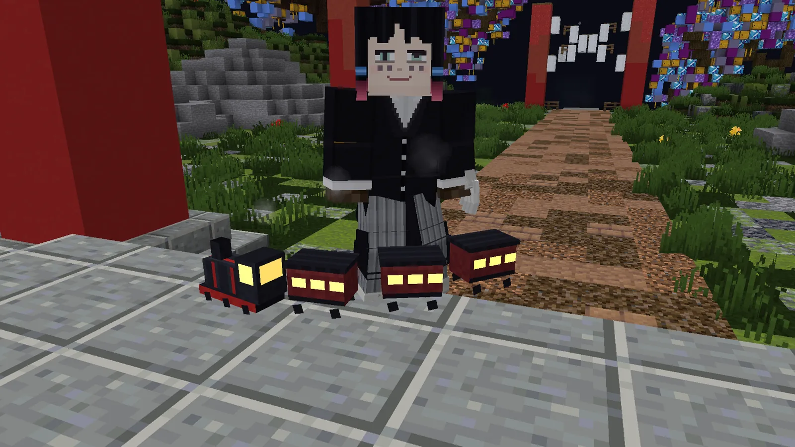
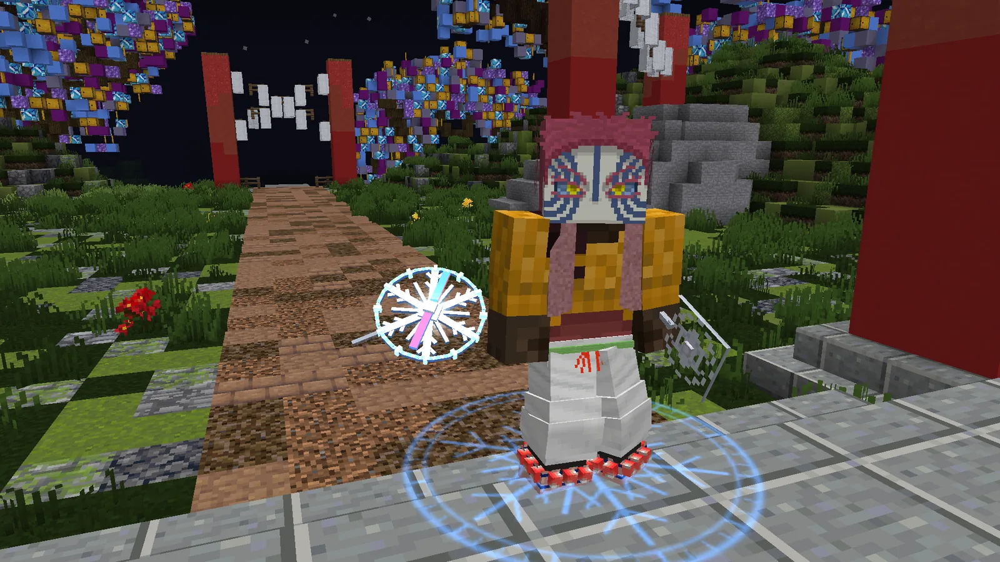
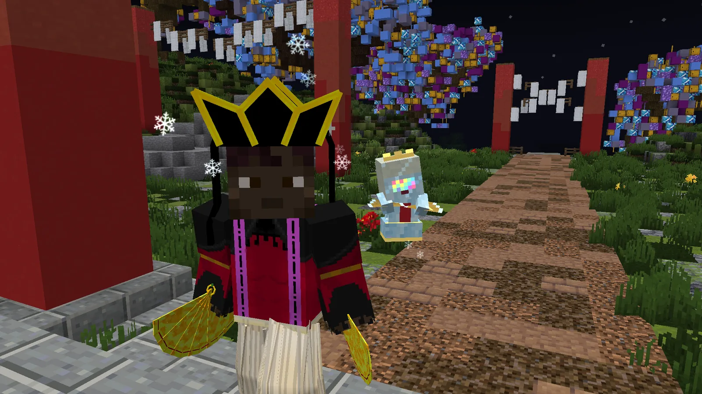
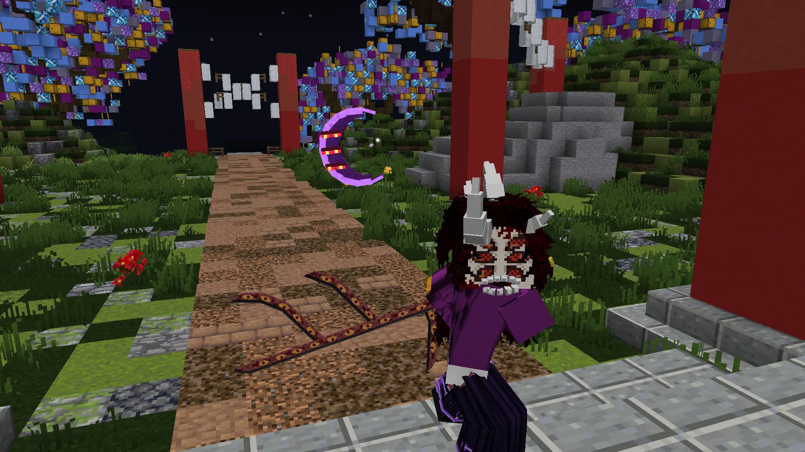

# Rangos de apoyo (VIP)

Los rangos de apoyo ayudan a mantener el servidor. Cada uno trae su propio equipo, una mascota y ventajas para tu cuenta; el más sencillo, el Amanecer, es solo de aspecto.

## Lo que da cualquier rango

- **Viajes a mitad de precio** (el cuervo, o la biwa si eres demonio).
- **+25 %** en todo lo que paga el servidor: misiones, encargos del día, recompensa nocturna, Luna de Sangre y, al demonio, su
  paga de la noche, la paga de Muzan y el Tablón de la Noche.
- **Todas las formas** de tus respiraciones, también las de la 7.ª en adelante.
- Un **kit semanal** con la ropa y la katana (o el arma) del rango: `/kit <id>`.
- Una **mascota** propia del rango que te acompaña: `/vip mascota`.
- **Su título** (se queda aunque el rango caduque), prefijo en el chat, nombre dorado con ✦ en la lista de jugadores,
  la línea «VIP · *RANGO*» sobre tu cabeza y un anuncio cuando entras al servidor.
- Si es un rango **del Cuerpo** (de cazador), la **Marca del Cazador** (++h++) con cualquier rango, con el poder de su pilar
  ([ver](#la-marca-de-cada-pilar)).

El **Amanecer** es la excepción: solo trae lo de aspecto (título, equipo, mascota y la línea sobre tu cabeza), sin viajes a mitad
de precio, sin el +25 %, sin las formas y sin la Marca. [Ver abajo](#amanecer-el-rango-de-aspecto).

## Los rangos

| | Rango | Para | Kit | Mascota | Lo especial |
|---|---|---|---|---|---|
| 【暁】 | **Amanecer** | Cazador | `/kit amanecer` (al mes) | Dragón del alba | **Solo aspecto**, sin ventajas. Su katana toma tu respiración. |
| 【水】 | **Pilar del Agua** | Cazador | `/kit agua` | Koi del agua | Con sus tabi **andas sobre el agua**. |
| 【雷】 | **Pilar Superior del Trueno** | Cazador | `/kit trueno` | Gorrión del trueno | Golpeas más rápido y saltas más. |
| 【霞】 | **Pilar de la Niebla** | Cazador | `/kit niebla` | Lechuza de la niebla | Agachado te vuelves invisible. |
| 【炎】 | **Pilar de la Llama** | Cazador | `/kit fuego` | Fénix de la llama | Inmune al fuego; lo que cortas arde. |
| 【音】 | **Pilar del Sonido** | Cazador | `/kit sonido` | Ave lira del sonido | [Dos katanas](#las-gemelas-del-sonido-y-de-la-bestia), una en cada mano; ves brillar a los enemigos cercanos. |
| 【獣】 | **La Bestia** | Cazador | `/kit bestia` | Jabato de la bestia | [Dos colmillos](#las-gemelas-del-sonido-y-de-la-bestia), uno en cada mano; rematas a los enemigos heridos. |
| 【灰】 | **Ceniza Oscura** | Cazador | `/kit cenizaoscura` | Zorro de ceniza | **Su propia respiración**: la Ceniza, cinco formas. |
| 【紅】 | **Oscuridad Carmesí** | Cazador | `/kit oscuridadcarmesi` | Mariposa del abismo | **Su propia respiración**: la Oscuridad Carmesí, cinco formas. |
| 【魂】 | **Señor de las Ánimas** | **Demonio** | `/kit animas` | Farol maldito | **Su propio linaje**: cinco artes de sangre que se suman a las tuyas. |
| 【夢】 | **Enmu** | **Demonio** | `/kit enmu` | Tren Infinito | [Una Luna](#las-lunas-rangos-de-demonio): su mano duerme a los cazadores del Cuerpo que te golpean. |
| 【破】 | **Akaza** | **Demonio** | `/kit akaza` | Brújula de Koyuki | [Una Luna](#las-lunas-rangos-de-demonio): pelea con los puños; cada tercer puñetazo abre la brújula. |
| 【氷】 | **Douma** | **Demonio** | `/kit douma` | Niño de Cristal | [Una Luna](#las-lunas-rangos-de-demonio): dos abanicos de hielo, uno en cada mano. |
| 【月】 | **Kokushibo** | **Demonio** | `/kit kokushibo` | Luna de los Seis Ojos | [Una Luna](#las-lunas-rangos-de-demonio): su espada, Kyokoku Kamusari, y seis ojos que ven lo que acecha. |

Ceniza Oscura, Oscuridad Carmesí y Señor de las Ánimas traen técnicas que no existen en ningún otro sitio del juego:

<figure markdown="span">
  { loading=lazy }
  <figcaption>Ceniza Oscura: la Respiración de la Ceniza.</figcaption>
</figure>
<figure markdown="span">
  { loading=lazy }
  <figcaption>Oscuridad Carmesí: su respiración de cinco formas.</figcaption>
</figure>
<figure markdown="span">
  { loading=lazy }
  <figcaption>Señor de las Ánimas: el rango de los demonios.</figcaption>
</figure>

<figure markdown="span">
  { loading=lazy }
  <figcaption>Ceniza Oscura: máscara de zorro, haori, pantalón, polainas y su hoja.</figcaption>
</figure>
<figure markdown="span">
  { loading=lazy }
  <figcaption>El zorro de ceniza, su compañero.</figcaption>
</figure>
<figure markdown="span">
  { loading=lazy }
  <figcaption>«Tormenta de Ceniza Negra», 5.ª forma de la Respiración de la Ceniza.</figcaption>
</figure>
<figure markdown="span">
  { loading=lazy }
  <figcaption>Oscuridad Carmesí: máscara de zorro carmesí, haori de llamas violetas y su hoja.</figcaption>
</figure>
<figure markdown="span">
  { loading=lazy }
  <figcaption>La mariposa del abismo, su compañera.</figcaption>
</figure>
<figure markdown="span">
  { loading=lazy }
  <figcaption>«Eclipse Carmesí», 4.ª forma de la Oscuridad Carmesí.</figcaption>
</figure>
<figure markdown="span">
  { loading=lazy }
  <figcaption>Señor de las Ánimas: máscara de oni, kimono, hakama, vendas y el farol.</figcaption>
</figure>
<figure markdown="span">
  { loading=lazy }
  <figcaption>«Desfile de los Cien Demonios», el arte mayor de las Ánimas.</figcaption>
</figure>
<figure markdown="span">
  { loading=lazy }
  <figcaption>K → Artes → «Ánimas»: cinco artes nuevas que se suman a las de tu linaje.</figcaption>
</figure>

- La **5.ª forma de la Ceniza** y la de la **Oscuridad Carmesí** atrapan y arrastran a quien está cerca y le dan siempre: no se
  paran con el bloqueo ni con la parada, no se esquivan rodando y la defensa del demonio no las frena.
- Con el **farol de las Ánimas** en la mano, su arte del clic derecho no alcanza a ningún jugador a más de **6 bloques**. Sin el
  farol, con Z, X y C, y contra los demonios de la noche y los jefes, igual que siempre.

## Las mascotas de los pilares

Cada rango de pilar trae **su propia mascota**, con su modelo, sus gestos, sus chispas y su voz. Se llama con `/vip mascota`.

| Rango | Mascota | Cómo es |
|---|---|---|
| Pilar del Agua | **Koi del agua** (`koi`) | Nada en un ocho alrededor de tu pecho, ondulando, y de vez en cuando salta. Deja caer gotas. |
| Pilar Superior del Trueno | **Gorrión del trueno** (`gorrion`) | Posado en tu hombro izquierdo, echando chispas; a veces da una vuelta volando sobre tu cabeza. |
| Pilar de la Niebla | **Lechuza de la niebla** (`lechuza`) | Planea junto a tu cabeza entre bruma blanca, gira la cabeza y ulula. |
| Pilar de la Llama | **Fénix de la llama** (`fenix`) | Da vueltas sobre tu cabeza con alas de fuego y tres colas, soltando brasas. |
| Pilar del Sonido | **Ave lira del sonido** (`avelira`) | Junto a tu hombro derecho, con su cola de plata. De vez en cuando **canta**: alza la cola en lira e imita sonidos. |
| La Bestia | **Jabato de la bestia** (`jabato`) | Trota junto a tu rodilla y, de vez en cuando, embiste hacia delante con los ojos encendidos. |

- Son compañía: no pelean ni se pueden tocar.
- En primera persona no ves la tuya si va pegada a la cámara (el gorrión del hombro), para que no te tape la vista; los demás
  sí la ven.
- El cuervo Kasugai ya no acude: si lo tenías elegido, ahora te acompaña la de tu pilar.

## Las gemelas del Sonido y de La Bestia

Los kits del **Pilar del Sonido** (dos «Nichirin Gemela») y de **La Bestia** (dos «Colmillo de la Bestia») traen dos hojas
que se llevan **una en cada mano**:

<ol class="pasos" markdown>
<li markdown>**Coge la segunda hoja en la mano y pulsa ++o++** (o arrástrala al hueco del escudo del inventario): pasa a la otra mano.</li>
<li markdown>**Coge la otra en la mano principal.** Ahora peleas **con las dos a la vez**, con su estilo de dos espadas, y te cubres con las dos.</li>
</ol>

!!! tip "Si la O no hace nada"
    Mira en *Opciones → Controles → Teclas* que la tecla de pasar el objeto a la otra mano siga en la ++o++ y que tengas el
    pack del juego al día.

- Van dobles **con cualquier respiración**: las formas son las de tu respiración activa y, si la cambias, siguen dobles.
- Con las dos puestas despierta lo suyo: con las del Sonido, cada corte suelta una onda que alcanza hasta a dos enemigos más;
  con los colmillos de La Bestia, golpeas más rápido y rematas lo que ya está muy herido. Nunca a otro jugador.

## La marca de cada pilar

Con un rango VIP **del Cuerpo** (los cinco Pilares, La Bestia, Ceniza Oscura u Oscuridad Carmesí), la
[Marca del Cazador](cazador/rangos.md#la-marca-del-cazador) (++h++) es tuya **al momento y con cualquier rango** del Cuerpo (sin
uno de estos rangos, despierta en Hashira). Al recibir el rango te lo dice el chat: *«Y tu Marca del Agua, ya despierta: tecla
H, 20 s de…»*.

Es la Marca de siempre (**20 s** de Regeneración II y **2 minutos** de descanso) y, además, **la de tu pilar**, con un aura de
su color:

| Rango | Su marca | Lo que te da durante sus 20 s |
|---|---|---|
| 【水】 Pilar del Agua | **Marca del Agua** | Resistencia, gracia del delfín y respirar bajo el agua. |
| 【雷】 Pilar Superior del Trueno | **Marca del Trueno** | Velocidad II, prisa II y salto. |
| 【霞】 Pilar de la Niebla | **Marca de la Niebla** | 5 s invisible, velocidad y caída lenta; esquivas uno de cada cinco golpes de los demonios. |
| 【炎】 Pilar de la Llama | **Marca de la Llama** | Fuerza y resistencia al fuego; tus golpes prenden a los demonios. |
| 【音】 Pilar del Sonido | **Marca del Sonido** | Prisa II y velocidad; los demonios a 32 bloques brillan y los ves a través de las paredes. |
| 【獣】 La Bestia | **Marca de la Bestia** | Velocidad II y salto II; cada golpe a un demonio te cura (un 15 % de lo que le quitas). |
| 【灰】 Ceniza Oscura | **Marca de la Ceniza** | Fuerza y velocidad; brasas negras en los demonios que golpeas: arden y se frenan. |
| 【紅】 Oscuridad Carmesí | **Marca Carmesí** | Resistencia y velocidad; robas vida a los demonios (un 20 % de lo que les quitas). |

- **Mientras dura, tus formas y tus técnicas del Cuerpo esperan un 20 % menos.**
- Lo que tu pilar hace a los demonios (esquivar, prenderlos, hacerlos brillar, curarte con sus golpes, las brasas) es solo
  contra los demonios del mundo, nunca contra un jugador.
- **En los duelos del dojo, nada**: tampoco la Marca de siempre («En el tatami la Marca duerme: los dos pelean igualados»).
- Con varios rangos del Cuerpo, la marca es la del conjunto que llevas puesto. **`/vip info`** te dice cuál es la tuya.
- Un demonio no tiene Marca. Si el rango caduca, la Marca vuelve a esperar al rango Hashira.

## Las Lunas: rangos de demonio

Cuatro rangos para **demonios**, como el Señor de las Ánimas: **Enmu**, **Akaza**, **Douma** y **Kokushibo**. Su ropa, su arma
y su conjunto solo funcionan **siendo demonio y con el rango**. Si eres cazador, tienes las ventajas de cuenta de
[cualquier rango](#lo-que-da-cualquier-rango) y su mascota; lo demás te espera para cuando te conviertas. No dan linaje: el de
la Luna, el del Hielo y el del Puño se ganan en el camino del demonio ([ver](demonio/artes.md#tu-linaje)), y la sangre de Enmu
(el Linaje del Sueño), con su propia cadena, en el Árbol de la Sangre ([ver](demonio/artes.md#el-linaje-del-sueno)).

**Lo de las cuatro** (siendo demonio, con el rango y sus piezas puestas; en el tatami del dojo no cuenta):

- **Cada pieza de ropa** suma armadura y dureza **encima de tu carne de demonio** (+6 de armadura y +4 de dureza con las
  cuatro) y te quita un **3 %** de lo que te hacen las formas de los cazadores, jugadores o del Cuerpo.
- **Pecho:** las artes de su linaje (Kokushibo, la Luna; Douma, el Hielo; Akaza, el Puño) se recargan un 10 % antes; con el
  de Enmu, todas tus artes. **Piernas:** más velocidad. **Pies:** saltas más y sin daño de caída.
- **Con el conjunto entero** (las cuatro piezas y su arma o lo de su mano izquierda): **+2 corazones**, un 2 % más contra las
  formas (un 14 % en total), **su despertar** al completarlo, **su aura**, que ve todo el mundo, y **su golpe de gracia**: cuando
  bajas del 30 % de vida recuperas 4 corazones y castiga a lo que te rodea (una vez cada 3 minutos). Lo de la mano de Enmu y
  de Akaza también pide el conjunto entero.
- **Sus armas** (los abanicos de Douma y la espada de Kokushibo) pegan como una buena nichirin (**8**) y **+2 con el rango**, y
  con ellas te cubres y paras. **Solo obedecen a un demonio con su rango**: regaladas, ni pegan ni cubren. Con un arma en la
  mano no hay garras.
- **Lo de la mano izquierda** (la horquilla de Akaza, la mano de Enmu, el segundo abanico de Douma) se pone con la ++o++, como
  [las gemelas](#las-gemelas-del-sonido-y-de-la-bestia). La tiara de Douma, con clic derecho.
- **Contra otro jugador** cuentan la armadura, la resistencia a sus formas y el daño de las armas; el sueño, la escarcha, la
  brújula, las lunas y el castigo del golpe de gracia son solo contra los cazadores del Cuerpo y las criaturas.
- **Si el rango caduca**, la ropa y el arma se quedan contigo, sin efectos: el arma deja de responderte.

| Luna | En la mano | Lo suyo | Golpe de gracia | Mascota |
|---|---|---|---|---|
| 【夢】 **Enmu** | **Mano del Sueño** (izquierda): el cazador del Cuerpo que te golpea se duerme 2 s | Nada te adormece: ni la ceguera, ni la oscuridad, ni el mareo | **Sueño Profundo**: todo a 8 bloques se duerme 4 s | Tren Infinito (`tren`) |
| 【破】 **Akaza** | **Horquilla de Koyuki** (izquierda) y tus puños: cada tercer puñetazo seguido al mismo enemigo abre la brújula (+2, y alcanza a otros dos) | Fuera de combate te recuperas medio corazón por segundo, y su pantalón hace que te empujen menos | **Copo de Koyuki**: hiere, aparta y debilita, y tú sales más rápido | Brújula de Koyuki (`brujula`) |
| 【氷】 **Douma** | **Dos Abanicos de Hielo**, uno en cada mano: hielan a los cazadores del Cuerpo y, con los dos, su soplo alcanza a otros dos | Nada te frena: ni la lentitud ni el hielo | **Loto de Escarcha**: hiere, frena y congela 4 s | Niño de Cristal (`nino`) |
| 【月】 **Kokushibo** | **Kyokoku Kamusari**, su espada: cada tajo a un cazador del Cuerpo alcanza también a otros dos | Los monstruos y cazadores del Cuerpo a 16 bloques brillan, aunque se escondan | **Luna Creciente**: una corona de lunas corta todo a 7 bloques y lo frena | Luna de los Seis Ojos (`luna`) |

Su kit, una vez por semana: `/kit enmu`, `/kit akaza`, `/kit douma` o `/kit kokushibo`. Su título es el de su Luna: «Luna
Inferior Uno» (Enmu), «Luna Superior Tres» (Akaza), «Luna Superior Dos» (Douma) y «Luna Superior Uno» (Kokushibo); si eres
cazador, otro a juego.

- **Los Niños de Cristal obedecen.** El Niño de Cristal de Douma, su mascota, es solo compañía. Los que pelean por ti son los
  **Niños de Cristal** del arte del linaje del Hielo, y ahora solo atacan lo que golpeas tú o lo que os hace daño, a ti o a
  ellos, en los últimos 10 segundos; nunca a quien tú no puedes atacar, y en un duelo, solo a tu rival. Ya no se van solos a
  por el muñeco del dojo ni a por lo primero que ven.
- **La máscara de Kokushibo tapa la cara.** Con el Rostro de los Seis Ojos puesto, el pelo, los cuernos o la cara pintada de
  tu skin ya no salen por encima: se ven los seis ojos y su melena.

<figure markdown="span">
  { loading=lazy }
  <figcaption>Enmu: Rostro del Soñador, Levita del Tren Infinito, Pantalón de Rayas y Zapatos del Andén.</figcaption>
</figure>
<figure markdown="span">
  { loading=lazy }
  <figcaption>Akaza: Rostro del Artista Marcial, Chaqueta del Soryu, Pantalón del Dojo, Vendas del Soryu y la horquilla.</figcaption>
</figure>
<figure markdown="span">
  { loading=lazy }
  <figcaption>Douma: Tiara del Paraíso Eterno, Hábito del Sumo Sacerdote, Hakama del Loto Blanco, Tabi de Escarcha y sus abanicos.</figcaption>
</figure>
<figure markdown="span">
  { loading=lazy }
  <figcaption>Kokushibo: Rostro de los Seis Ojos, Kimono del Primer Espadachín, Hakama de la Luna Creciente y Tabi de la Primera Luna.</figcaption>
</figure>
<figure markdown="span">
  { loading=lazy }
  <figcaption>El Tren Infinito da vueltas a tu alrededor.</figcaption>
</figure>
<figure markdown="span">
  { loading=lazy }
  <figcaption>La Brújula de Koyuki: su aguja señala al enemigo más cercano.</figcaption>
</figure>
<figure markdown="span">
  { loading=lazy }
  <figcaption>El Niño de Cristal abanica y baila a tu lado.</figcaption>
</figure>
<figure markdown="span">
  { loading=lazy }
  <figcaption>La Luna de los Seis Ojos y Kyokoku Kamusari.</figcaption>
</figure>

## Amanecer: el rango de aspecto

{ align=right width="260" loading=lazy }

El rango más sencillo y **solo de aspecto**: no da ninguna ventaja, ni en combate ni en tu cuenta (ni viajes a mitad de precio,
ni el +25 %, ni las formas, ni la Marca). Lo suyo es verse:

- **Sobre tu nombre**, «VIP · AMANECER» con los colores del alba y un destello que lo recorre; el prefijo 【暁】 en el chat y su
  título, «Amanecer» (o «Ocaso» si eres demonio).
- **Su equipo**, con `/kit amanecer` **una vez al mes**: el haori del Primer Amanecer (de la noche de los hombros al oro del bajo,
  con el sol naciente a la espalda), su hakama, sus polainas y la **Hoja del Primer Amanecer**, una katana cuyo lomo es la noche y
  cuyo filo es el alba.
- **La katana no tiene respiración propia**: en cuanto la empuñas toma la tuya (K → Respiración), con todas sus formas, y se sigue
  viendo igual. Se gasta como cualquier hoja: la repara Hotaru Haganezuka en la [Aldea de los Herreros](economia/aldea.md).
- **Con el conjunto entero y la katana en la mano**, despierta el alba: un sol nace a tu espalda y se abre un aro de luz a tus
  pies. Al golpear, la hoja suelta destellos de luz, y lo que matas se deshace en luz.
- **Su mascota, el dragón del alba** (`/vip mascota`): un dragón pequeño que nada a tu espalda persiguiendo su perla, del oro de
  la cabeza al violeta de la cola. Se pone en guardia si hay monstruos cerca, canta de vez en cuando y saluda al sol cada mañana.
  No pelea: es solo compañía.

<figure markdown="span">
  { loading=lazy }
  <figcaption>El haori del Primer Amanecer: el sol que nace a la espalda.</figcaption>
</figure>
<figure markdown="span">
  { loading=lazy }
  <figcaption>La Hoja del Primer Amanecer: de noche, el filo se ve encendido.</figcaption>
</figure>
<figure markdown="span">
  { loading=lazy }
  <figcaption>El dragón del alba, su mascota, con su perla.</figcaption>
</figure>
<figure markdown="span">
  { loading=lazy }
  <figcaption>Cuando sale el sol, el dragón lo saluda.</figcaption>
</figure>

## El equipo del rango

Los efectos del equipo funcionan cuando **tienes el rango y llevas sus piezas puestas** (siendo del bando del rango).
En el tatami del dojo no cuentan.

- **Pecho:** regeneración cuando llevas 10 segundos sin recibir golpes. **Botas:** sin daño de caída. **Katana:** +2 de daño.
- **Con el conjunto completo** (las cuatro piezas y la katana en la mano): +2 corazones, regeneración más fuerte, una
  estela al esprintar y un **golpe de gracia** automático cuando bajas del 30 % de vida (una vez cada 3 minutos).
- Cada rango tiene además sus efectos propios en la cabeza, las piernas y los pies (los de la tabla de arriba).
- **Regalar la ropa no regala el rango:** sin el rango, la ropa es solo aspecto. La katana del kit solo funciona con su rango.
- **Si el rango caduca:** la ropa se queda contigo sin efectos, la katana del kit se va y el título se queda.
- **El Amanecer** no tiene ninguno de estos efectos: su equipo es solo aspecto.
- **Los rangos de demonio** (Señor de las Ánimas y [las Lunas](#las-lunas-rangos-de-demonio)) no llevan la regeneración del
  pecho ni la katana: tienen lo suyo, más arriba.

## Si tienes varios rangos

Tú eliges qué rango enseñas y qué mascota te acompaña:

- **`/vip titulo`**: tus títulos VIP para pulsar. El que elijas sale en **todo**: la línea sobre tu cabeza, el prefijo del chat,
  tu nombre en los mensajes del servidor, tu anuncio al entrar y tu título. También lo eliges poniéndote su título en
  **K → Títulos**.
- **`/vip mascota <cuál>`**: `koi`, `gorrion`, `lechuza`, `fenix`, `avelira`, `jabato`, `zorro`, `mariposa`, `farol`,
  `dragon`, `tren`, `brujula`, `nino` o `luna`. Al llamar a tu mascota con `/vip mascota` verás las demás para cambiar
  pulsando. Seas cazador o demonio, te acompaña cualquiera de las de tus rangos.
- Con **`ropa`** (`/vip titulo ropa`, `/vip mascota ropa`) vuelves a lo de siempre: lo del conjunto que llevas puesto.

Elegir no cambia tus ventajas: los efectos siguen siendo los del conjunto que llevas puesto. Un rango nuevo se pone a la vista
con su mascota en cuanto te llega.

## Comandos

| Comando | Qué hace |
|---|---|
| `/vip info` | Tu rango, tus ventajas (también tu marca, si es un rango del Cuerpo) y cuándo te toca el próximo kit. |
| `/vip mascota` | Llama o despide a tu mascota. |
| `/vip mascota <cuál>` | Con varios rangos, elige qué mascota te acompaña (`ropa`: la de tu conjunto). |
| `/vip titulo` | Con varios rangos, elige qué rango enseñas (`/vip titulo <rango>`, o `ropa`). |
| `/kit` | Lista tus kits y cuándo puedes recogerlos. |
| `/kit <id>` | Recoge el kit de tu rango (una vez cada 7 días; el del Amanecer, una vez al mes; necesitas hueco en el inventario). |

## Cómo conseguirlo

- En la **tienda de DemonCraft**: [fartherlands-webstore.tebex.io](https://fartherlands-webstore.tebex.io).
  Dentro del juego, **`/buy`** abre el menú de la tienda.
- Compra con **tu nombre de jugador exacto** y **estando conectado**: el rango llega en unos minutos, con una ceremonia
  y un anuncio a todo el servidor.

### Otros extras de la tienda

{ align=right width="180" loading=lazy }

- **Metal nichirin premium:** cada lingote es una tirada de la **Caja Premium** (K → Caja), que da una de las cinco
  **hojas legendarias** ([ver](economia/objetos.md#la-caja-premium-las-cinco-hojas-legendarias)).
- **Pase Premium:** la fila dorada del [Pase Estelar](pase.md) de la temporada: una recompensa más en cada nivel y un 20 % más
  de experiencia.
- **Sangre Premium:** cada vial es una tirada de la **Caja de Sangre** del demonio (K → Caja o `/caja`), con cinco armas
  legendarias que no son espadas ([ver](economia/objetos.md#la-caja-de-sangre-demonios)). Solo la abre un demonio.
- **Sello de Sangre:** para quien cambia de bando muchas veces ([ver la cura](demonio/cura.md)).
- Hojas y prendas de **aspecto**, sin efectos.
