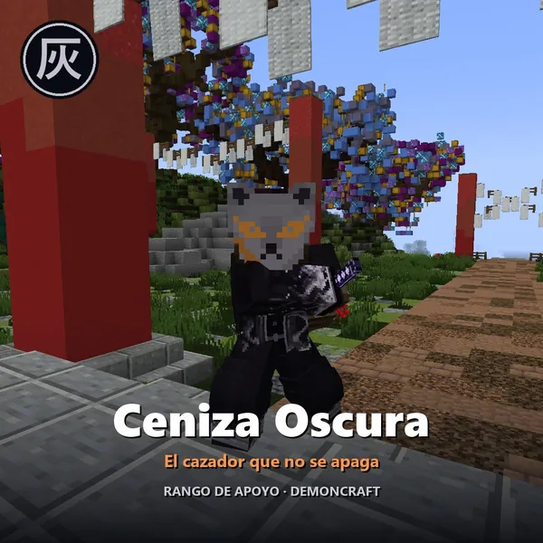
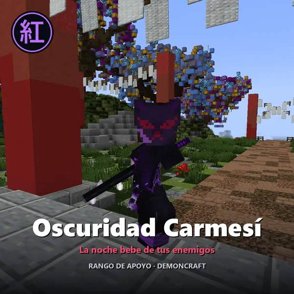
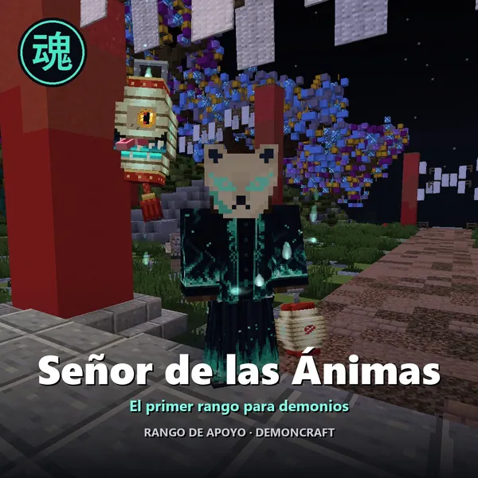
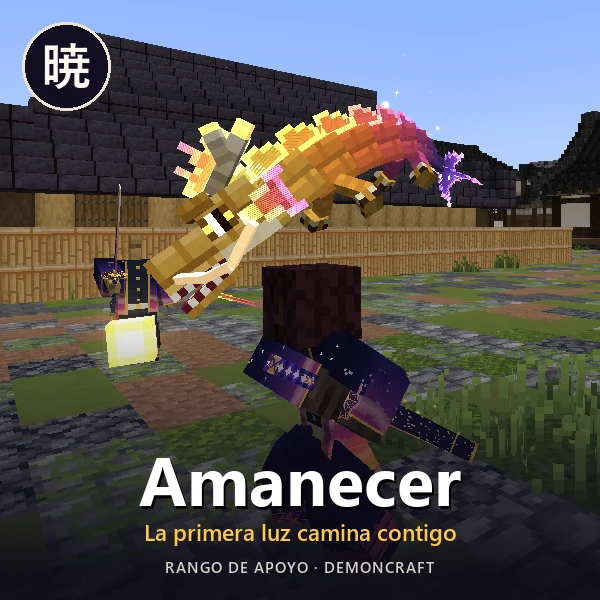
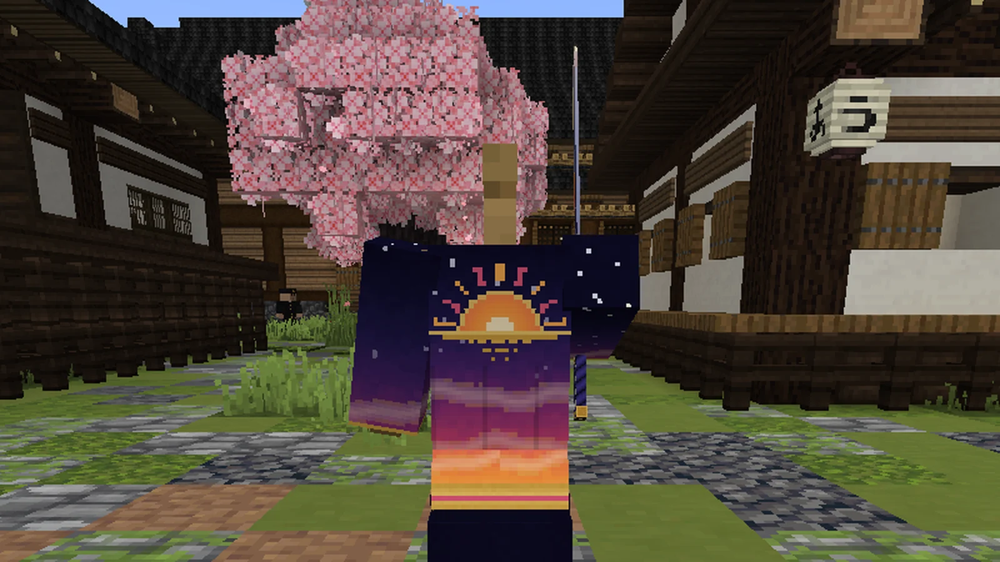
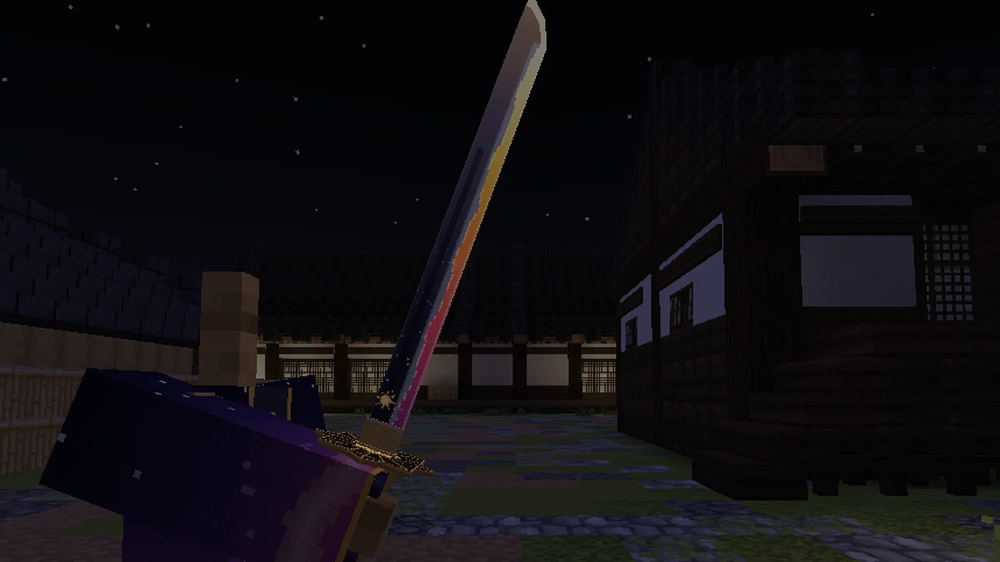
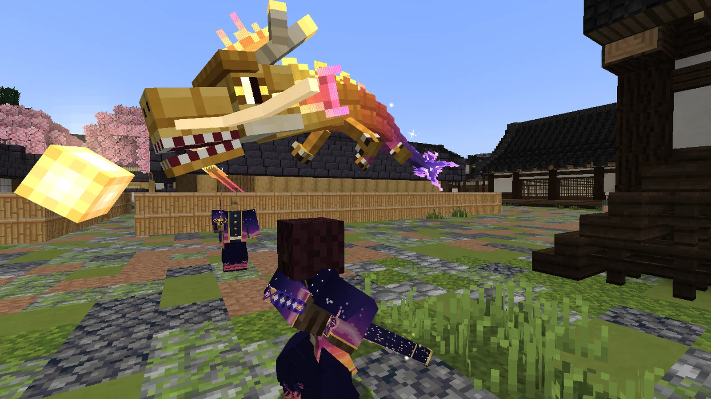
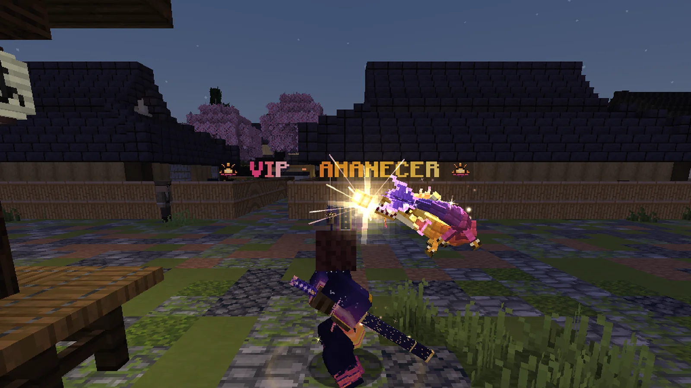
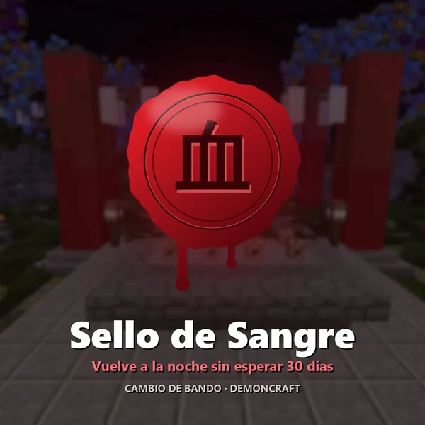

# Rangos de apoyo (VIP)

Los rangos de apoyo ayudan a mantener el servidor. Cada uno trae su propio equipo, una mascota y ventajas para tu cuenta; el más sencillo, el Amanecer, es solo de aspecto.

## Lo que da cualquier rango

- **Viajes a mitad de precio** (el cuervo, o la biwa si eres demonio).
- **+25 %** en todo lo que paga el servidor: misiones, encargos del día, recompensa nocturna y Luna de Sangre.
- **Todas las formas** de tus respiraciones, también las de la 7.ª en adelante.
- Un **kit semanal** con la ropa y la katana del rango: `/kit <id>`.
- Una **mascota** que te acompaña: `/vip mascota`.
- **Su título** (se queda aunque el rango caduque), prefijo en el chat, nombre dorado con ✦ en la lista de jugadores,
  la línea «VIP · *RANGO*» sobre tu cabeza y un anuncio cuando entras al servidor.

El **Amanecer** es la excepción: solo trae lo de aspecto (título, equipo, mascota y la línea sobre tu cabeza), sin viajes a mitad
de precio, sin el +25 % y sin las formas. [Ver abajo](#amanecer-el-rango-de-aspecto).

## Los rangos

| | Rango | Para | Kit | Mascota | Lo especial |
|---|---|---|---|---|---|
| 【暁】 | **Amanecer** | Cazador | `/kit amanecer` (al mes) | Dragón del alba | **Solo aspecto**, sin ventajas. Su katana toma tu respiración. |
| 【水】 | **Pilar del Agua** | Cazador | `/kit agua` | Cuervo Kasugai | Con sus tabi **andas sobre el agua**. |
| 【雷】 | **Pilar Superior del Trueno** | Cazador | `/kit trueno` | Cuervo Kasugai | Golpeas más rápido y saltas más. |
| 【霞】 | **Pilar de la Niebla** | Cazador | `/kit niebla` | Cuervo Kasugai | Agachado te vuelves invisible. |
| 【炎】 | **Pilar de la Llama** | Cazador | `/kit fuego` | Cuervo Kasugai | Inmune al fuego; lo que cortas arde. |
| 【音】 | **Pilar del Sonido** | Cazador | `/kit sonido` | Cuervo Kasugai | Dos katanas; ves brillar a los enemigos cercanos. |
| 【獣】 | **La Bestia** | Cazador | `/kit bestia` | Cuervo Kasugai | Dos colmillos; rematas a los enemigos heridos. |
| 【灰】 | **Ceniza Oscura** | Cazador | `/kit cenizaoscura` | Zorro de ceniza | **Su propia respiración**: la Ceniza, cinco formas. |
| 【紅】 | **Oscuridad Carmesí** | Cazador | `/kit oscuridadcarmesi` | Mariposa del abismo | **Su propia respiración**: la Oscuridad Carmesí, cinco formas. |
| 【魂】 | **Señor de las Ánimas** | **Demonio** | `/kit animas` | Farol maldito | **Su propio linaje**: cinco artes de sangre que se suman a las tuyas. |

Los tres últimos traen técnicas que no existen en ningún otro sitio del juego:

<figure markdown="span">
  { loading=lazy }
  <figcaption>Ceniza Oscura: la Respiración de la Ceniza.</figcaption>
</figure>
<figure markdown="span">
  { loading=lazy }
  <figcaption>Oscuridad Carmesí: su respiración de cinco formas.</figcaption>
</figure>
<figure markdown="span">
  { loading=lazy }
  <figcaption>Señor de las Ánimas: el rango de los demonios.</figcaption>
</figure>

<figure markdown="span">
  { loading=lazy }
  <figcaption>Ceniza Oscura: máscara de zorro, haori, pantalón, polainas y su hoja.</figcaption>
</figure>
<figure markdown="span">
  { loading=lazy }
  <figcaption>El zorro de ceniza, su compañero.</figcaption>
</figure>
<figure markdown="span">
  { loading=lazy }
  <figcaption>«Tormenta de Ceniza Negra», 5.ª forma de la Respiración de la Ceniza.</figcaption>
</figure>
<figure markdown="span">
  { loading=lazy }
  <figcaption>Oscuridad Carmesí: máscara de zorro carmesí, haori de llamas violetas y su hoja.</figcaption>
</figure>
<figure markdown="span">
  { loading=lazy }
  <figcaption>La mariposa del abismo, su compañera.</figcaption>
</figure>
<figure markdown="span">
  { loading=lazy }
  <figcaption>«Eclipse Carmesí», 4.ª forma de la Oscuridad Carmesí.</figcaption>
</figure>
<figure markdown="span">
  { loading=lazy }
  <figcaption>Señor de las Ánimas: máscara de oni, kimono, hakama, vendas y el farol.</figcaption>
</figure>
<figure markdown="span">
  { loading=lazy }
  <figcaption>«Desfile de los Cien Demonios», el arte mayor de las Ánimas.</figcaption>
</figure>
<figure markdown="span">
  { loading=lazy }
  <figcaption>K → Artes → «Ánimas»: cinco artes nuevas que se suman a las de tu linaje.</figcaption>
</figure>

## Amanecer: el rango de aspecto

{ align=right width="260" loading=lazy }

El rango más sencillo y **solo de aspecto**: no da ninguna ventaja, ni en combate ni en tu cuenta (ni viajes a mitad de precio,
ni el +25 %, ni las formas, ni la estancia). Lo suyo es verse:

- **Sobre tu nombre**, «VIP · AMANECER» con los colores del alba y un destello que lo recorre; el prefijo 【暁】 en el chat y su
  título, «Amanecer» (o «Ocaso» si eres demonio).
- **Su equipo**, con `/kit amanecer` **una vez al mes**: el haori del Primer Amanecer (de la noche de los hombros al oro del bajo,
  con el sol naciente a la espalda), su hakama, sus polainas y la **Hoja del Primer Amanecer**, una katana cuyo lomo es la noche y
  cuyo filo es el alba.
- **La katana no tiene respiración propia**: en cuanto la empuñas toma la tuya (K → Respiración), con todas sus formas, y se sigue
  viendo igual. Se gasta como cualquier hoja: la repara Hotaru Haganezuka en la [Aldea de los Herreros](economia/aldea.md).
- **Con el conjunto entero y la katana en la mano**, despierta el alba: un sol nace a tu espalda y se abre un aro de luz a tus
  pies. Al golpear, la hoja suelta destellos de luz, y lo que matas se deshace en luz.
- **Su mascota, el dragón del alba** (`/vip mascota`): un dragón pequeño que nada a tu espalda persiguiendo su perla, del oro de
  la cabeza al violeta de la cola. Se pone en guardia si hay monstruos cerca, canta de vez en cuando y saluda al sol cada mañana.
  No pelea: es solo compañía.

<figure markdown="span">
  { loading=lazy }
  <figcaption>El haori del Primer Amanecer: el sol que nace a la espalda.</figcaption>
</figure>
<figure markdown="span">
  { loading=lazy }
  <figcaption>La Hoja del Primer Amanecer: de noche, el filo se ve encendido.</figcaption>
</figure>
<figure markdown="span">
  { loading=lazy }
  <figcaption>El dragón del alba, su mascota, con su perla.</figcaption>
</figure>
<figure markdown="span">
  { loading=lazy }
  <figcaption>Cuando sale el sol, el dragón lo saluda.</figcaption>
</figure>

## El equipo del rango

Los efectos del equipo funcionan cuando **tienes el rango y llevas sus piezas puestas** (siendo del bando del rango).
En el tatami del dojo no cuentan.

- **Pecho:** regeneración cuando llevas 10 segundos sin recibir golpes. **Botas:** sin daño de caída. **Katana:** +2 de daño.
- **Con el conjunto completo** (las cuatro piezas y la katana en la mano): +2 corazones, regeneración más fuerte, una
  estela al esprintar y un **golpe de gracia** automático cuando bajas del 30 % de vida (una vez cada 3 minutos).
- Cada rango tiene además sus efectos propios en la cabeza, las piernas y los pies (los de la tabla de arriba).
- **Regalar la ropa no regala el rango:** sin el rango, la ropa es solo aspecto. La katana del kit solo funciona con su rango.
- **Si el rango caduca:** la ropa se queda contigo sin efectos, la katana del kit se va y el título se queda.
- **El Amanecer** no tiene ninguno de estos efectos: su equipo es solo aspecto.

## Comandos

| Comando | Qué hace |
|---|---|
| `/vip info` | Tu rango, tus ventajas y cuándo te toca el próximo kit. |
| `/vip mascota` | Llama o despide a tu mascota. |
| `/kit` | Lista tus kits y cuándo puedes recogerlos. |
| `/kit <id>` | Recoge el kit de tu rango (una vez cada 7 días; el del Amanecer, una vez al mes; necesitas hueco en el inventario). |

## Cómo conseguirlo

- En la **tienda de DemonCraft**: [fartherlands-webstore.tebex.io](https://fartherlands-webstore.tebex.io).
  Dentro del juego, **`/buy`** abre el menú de la tienda.
- Compra con **tu nombre de jugador exacto** y **estando conectado**: el rango llega en unos minutos, con una ceremonia
  y un anuncio a todo el servidor.

### Otros extras de la tienda

{ align=right width="180" loading=lazy }

- **Metal nichirin premium:** cada lingote es una tirada de la **Caja Premium** (K → Caja), que da una de cinco hojas personalizadas.
- **Sello de Sangre:** para quien cambia de bando muchas veces ([ver la cura](demonio/cura.md)).
- Hojas y prendas de **aspecto**, sin efectos.
